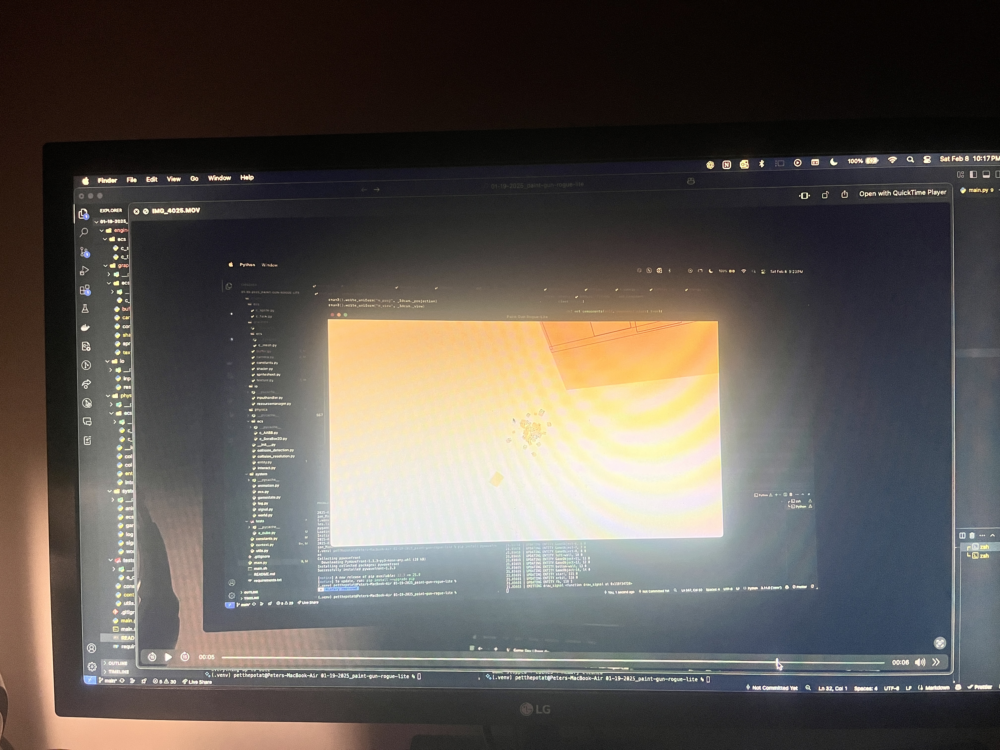
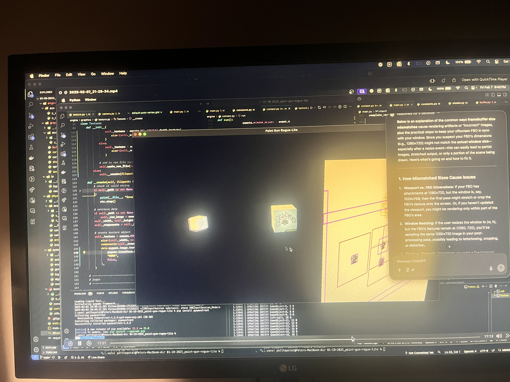
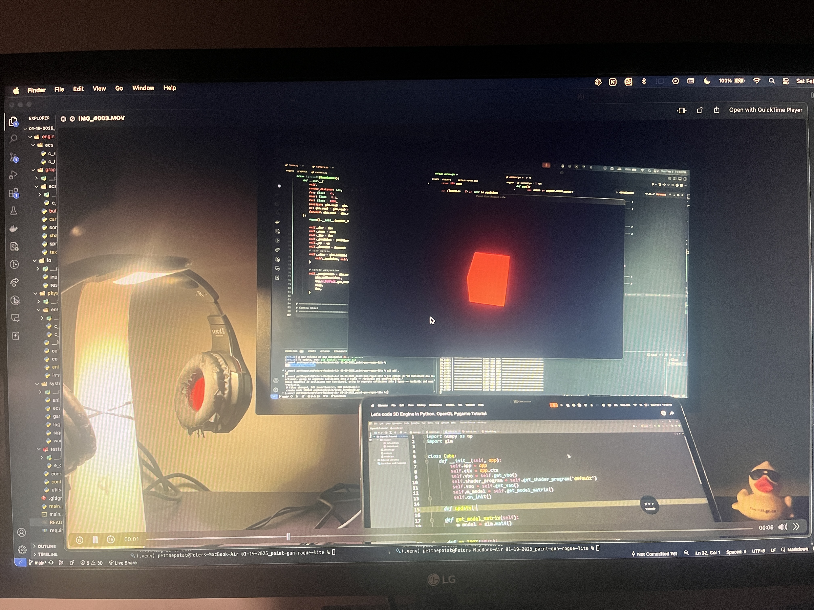
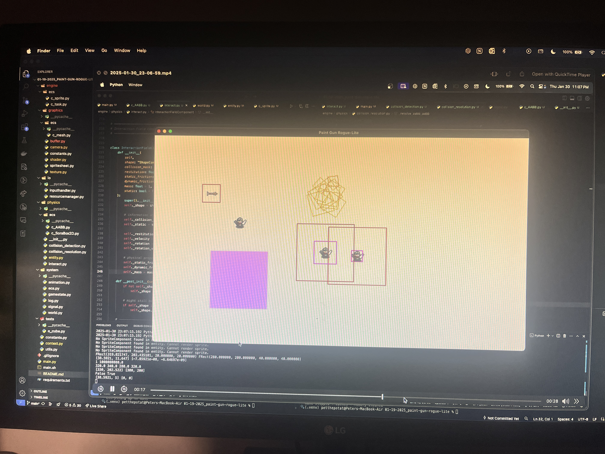
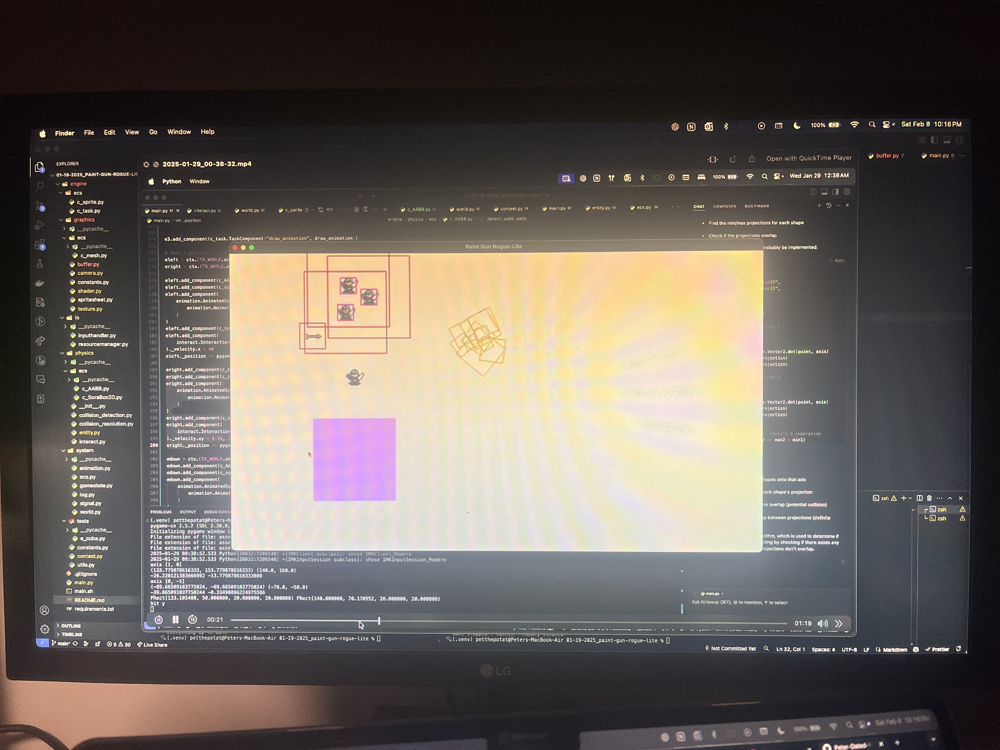
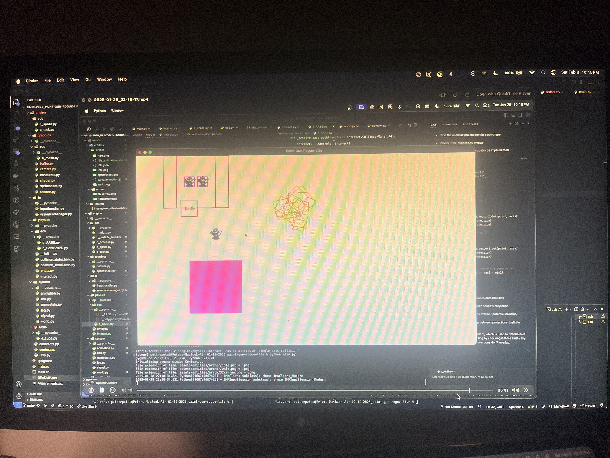

# SoraGL

A Python game engine for 2D and 3D games, built on [pygame-ce](https://pyga.me),
[moderngl](https://github.com/moderngl/moderngl) and Box2D. It has an entity-component
system, 2D physics, a resource manager, GPU texture management, an OBJ model loader, and an
audio engine with 2D and 3D positional sound.

Status: pre-alpha. The API will change.

## Install

SoraGL needs Python 3.11 to 3.13 (Box2D has no wheels for 3.14 yet) and an OpenGL 3.3 core
driver. Use it from another project with [uv](https://docs.astral.sh/uv/):

```bash
# a pinned release from git
uv add git+https://github.com/<you>/soragl@v0.1.0

# or a local checkout you are still editing
uv add --editable ../soragl-game-engine
```

## Quick start

```python
import soragl
from soragl import state
from soragl.audio import Attenuation
from soragl.audio.ecs import c_audio_listener, c_audio_source
from soragl.config import EngineConfig
from soragl.physics import entity

soragl.init(EngineConfig(window_title="My game"))
state.resource_manager.add_search_path("assets")  # so you can write "hit.wav"

player = state.world.add_entity(entity.Entity(name="player"))
player.add_component(c_audio_listener.AudioListenerComponent())

campfire = state.world.add_entity(entity.Entity(name="campfire"))
campfire._position.xy = (300, 0)
campfire.add_component(
    c_audio_source.AudioSourceComponent(
        "fire.ogg",
        loop=True,
        attenuation=Attenuation(min_distance=50, max_distance=800),  # pixels in 2D
    )
)

soragl.run()
```

Asset paths are resolved against the working directory first, then against any directory
added with `add_search_path`. Run `uv run python examples/spatial_audio/main.py` for a
working version that circles a sound around you.

## What is in it

| Area | Module | Notes |
| --- | --- | --- |
| Config and state | `soragl.config`, `soragl.state` | `EngineConfig` is passed to `init()`. Runtime objects live on `state`. |
| ECS | `soragl.system.ecs`, `*/ecs/c_*.py` | Components sit next to the domain they belong to. |
| Resources | `soragl.io.resource_manager` | Image, audio, model, json, text and bytes. Cached, ref counted, scoped, with stats. |
| Models | `soragl.io.model` | `.obj` and `.mtl` into unindexed `float32` vertices (`3f 2f 3f`). |
| Textures | `soragl.graphics.texture` | Filter, wrap, anisotropy, mipmaps and flips are part of the cache key. Render targets. |
| Audio | `soragl.audio` | Buses, voice pool with priorities, music, distance models, stereo panning. |
| Physics | `soragl.physics` | AABB and Box2D-backed colliders, SAT detection and resolution. |

### Resources and textures

```python
from soragl.graphics.texture import TextureSettings

resources = state.resource_manager
level = resources.load("levels/one.json")  # parsed json
cat = resources.load("models/cat.obj")  # ModelData: .vertices, .groups, .materials

with resources.scope() as scope:  # released and freed when the block ends
    scope.load("music/boss.ogg")

crisp = state.texture_manager.load(
    "hero.png", TextureSettings(filter="nearest", mipmaps=False)
)
state.texture_manager.release(crisp)
state.texture_manager.collect()  # frees textures nobody references
print(resources.stats())  # count, bytes, per kind
```

### Audio

```python
audio = state.audio
audio.set_bus_volume("music", 0.6)
audio.play("hit.wav", priority=5)  # plain sound
audio.play("growl.wav", position=(10, 0, -4))  # 3D position
audio.play_music("theme.ogg", fade_ms=1000)
```

Positioned sound uses distance attenuation (`INVERSE`, `LINEAR`, `EXPONENTIAL`, `NONE`) and
constant-power stereo panning relative to the listener. It does not do HRTF, front/back
cues or Doppler. If the machine has no audio device the engine logs a warning and every
audio call becomes a no-op.

### 2D games

```python
import pygame
import soragl
from soragl import state
from soragl.config import EngineConfig
from soragl.system.game_state import GameState

soragl.init(EngineConfig(render_mode="2d", framebuffer_width=480, framebuffer_height=270))


class Play(GameState):
    def update(self):
        pygame.draw.circle(state.framebuffer_surface, (255, 200, 80), (240, 135), 20)


state.game_state_manager.add_game_state("play", Play("play"))
state.game_state_manager.set_game_state("play")
soragl.run()                                          # scaled to the window, pixels kept sharp
```

## Layout

```
src/soragl/
  audio/       engine, spatial math, listener and source components
  ecs/         general-purpose components (sprites, tasks, particles)
  graphics/    buffers, camera, shaders, textures, sprite sheets
  io/          input, resource manager, model loader
  physics/     entities, interaction field, collision detection and resolution
  system/      ECS core, world, game state, signals, animation, logging
  data/        shaders bundled with the package
examples/      archer_demo (full demo), spatial_audio
tests/         unit/ (pure logic) and e2e/ (real pygame, mixer and OpenGL objects)
docs/          architecture.md
```

## Development

```bash
uv sync                       # create .venv and install everything, including dev tools
uv run pytest                 # tests (OpenGL tests skip when no GL context is available)
uv run ruff check             # lint
uv run ruff format            # format
uv run python examples/archer_demo/main.py
uv build                      # sdist + wheel in dist/
```

Conventions: `snake_case` for modules, functions and variables, `PascalCase` for classes.
Component modules start with `c_`. Log through `logging.getLogger(__name__)`; call
`soragl.system.log.configure()` in your app to see the output.

## About the game

Welcome to game development with Peter! Today we will be coding the greatest game to ever
walk the earth. Walk. No.. more like `ink` the earth haha... yeah its an ink game.
**Splatoon** but better and rogue-lite and with **teleportation** because that's always nice.

Also...

We've got anime based lore lol. That's good right? Kinda like `Wistoria` but **ink** and
**squids** and **gun** and **teleport**.

### Development log

I should start a YouTube series for this if I want to get anywhere.

### Images

Hey. Here are some images of my work so far.







